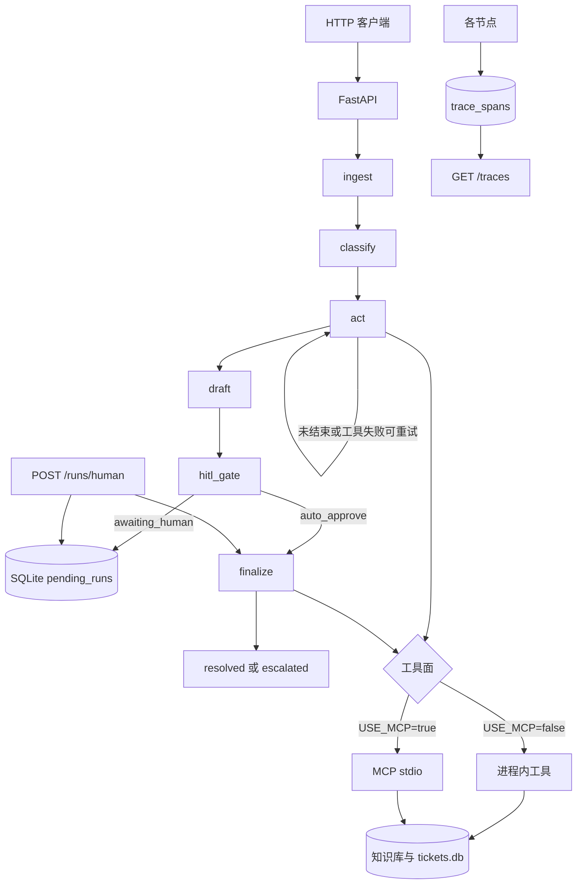

# 工单分流 Agent（P1 + P2 MCP）

面向 AI Agent 工程师作品集的 LangGraph **工单分流**工作流：分类 → 白名单内自选工具 → 起草回复 → **人工审核（HITL）** → 结案/升级。

- 锁定决策：见 [docs/DECISIONS.md](docs/DECISIONS.md)
- P2 MCP 用法：见 [docs/MCP.md](docs/MCP.md)
- P2/P3 验收：见 [docs/P2_MCP_P3_EVALS.md](docs/P2_MCP_P3_EVALS.md)
- 第一周清单：见 [docs/WEEK1_CHECKLIST.md](docs/WEEK1_CHECKLIST.md)
- 作品集路线：见 [docs/PORTFOLIO_ROADMAP.md](docs/PORTFOLIO_ROADMAP.md)
- P6 检索改调问答服务：见 [docs/P6.md](docs/P6.md)
- P7 工具调用计划：见 [docs/P7_AGENT_PLAN.md](docs/P7_AGENT_PLAN.md)

## 架构



```text
START → ingest → classify → act ⇄ (最多 4 步，失败可重试) → draft → hitl_gate
                                                                 ├─ awaiting_human（写入 SQLite 后暂停）
                                                                 └─ finalize → END

act 只可选 search_knowledge_base、get_ticket_history，或 finish。
update_ticket_status 只能由 finalize 在人审之后调用。

act / finalize 工具面：
  未设置 RAG_BASE_URL、USE_MCP=false → 进程内关键词工具
  RAG_BASE_URL=http://127.0.0.1:8001 → 知识库检索改调 citation-rag-agent
  USE_MCP=true → MCP stdio 客户端 → python -m mcp_server
```

| 节点 | 职责 |
|------|------|
| `ingest` | 写入共享 SQLite 工单库 |
| `classify` | 优先级 + 类别（有 Key 时由模型判断，失败退回关键词） |
| `act` | 在白名单里选择检索或查历史；`other` 的 stub 不检索；失败可软降级重试 |
| `draft` | 回复草稿 + 引用 |
| `hitl_gate` | 除非 `auto_approve`，否则暂停等人审 |
| `finalize` | 结案或升级（经网关写状态） |

## 快速开始

```bash
python -m venv .venv
# Windows: .venv\Scripts\activate
pip install -e ".[dev]"
pytest
# 显式运行需要拉起 MCP stdio 子进程的集成测试：
pytest -m integration
uvicorn ticket_triage.api.main:app --reload --port 8000
```

发起一次运行：

```bash
curl -X POST http://127.0.0.1:8000/runs -H "Content-Type: application/json" -d "{\"ticket\":{\"ticket_id\":\"t-1\",\"subject\":\"Urgent refund\",\"body\":\"Charged twice\"},\"auto_approve\":false}"
```

人工通过 / 驳回：

```bash
curl -X POST http://127.0.0.1:8000/runs/human -H "Content-Type: application/json" -d "{\"ticket_id\":\"t-1\",\"approved\":true}"
```

停进程后再恢复的完整演示：`powershell -File .\scripts\demo_hitl.ps1`，记录见 [docs/DEMO.md](docs/DEMO.md)。

审核台：启动 API 后打开 http://127.0.0.1:8000/review 。可以新建工单、看草稿和引用、通过或驳回，并看到各节点耗时。已处理工单列在左侧，可以重新送审，原来的结案或升级记录会留在历史里。

### 用真实模型分类和起草

默认是 stub，测试和 CI 不需要 Key。设置后，类别、优先级和草稿都由模型产生：

```powershell
$env:LLM_PROVIDER="anthropic"   # 或 openai；本机 .env 已指向 DeepSeek 时可直接跑
$env:ANTHROPIC_API_KEY="..."    # openai 则设 OPENAI_API_KEY，可选 OPENAI_BASE_URL
python evals/run_evals.py
```

不设模型时，同一条命令走 stub，这就是 CI 的门禁。评测会忽略 `RAG_BASE_URL`，固定用仓库里的 3 篇关键词文档。

分类只能落在现有的四个类别和四个优先级里。不合规、超时或不是 JSON 时，退回关键词结果并记 `classify_model_failed`。起草时提示里只给本次检索到的文档。模型返回的引用编号不在其中时会被删掉；没有检索结果时引用为空。模型这条路径上，任何一张工单的分类、工具调度或草稿退回 stub，评测都会失败；延迟只记录，不卡 2 秒预算。约 40 条黄金集还要求非法工具调用为 0。stub 的工具选择必须全对；模型路径的工具选择准确率门槛是 0.70。

### 开启 MCP 工具面

```powershell
$env:USE_MCP="true"
uvicorn ticket_triage.api.main:app --reload --port 8000
```

单独启动 MCP Server（给 Cursor / Claude Desktop）：

```powershell
python -m mcp_server
```

配置片段与安全说明见 [docs/MCP.md](docs/MCP.md)。

## 安全说明（工具面）

- 仅 3 个工具：`search_knowledge_base`、`get_ticket_history`、`update_ticket_status`
- **禁止**：shell、任意文件读写、任意 SQL
- 写操作 `status` 白名单：`open|resolved|escalated|pending`，并打审计日志
- MCP 调用默认 5 秒超时；超时记 `enrich_failed` 后软降级起草

## 失败模式（面试可讲）

| 失败 | 行为 |
|------|------|
| 知识库 / 工具报错 / MCP 超时 / 问答服务连不上 | 最多重试 `max_tool_retries` 次，然后无引用起草 |
| 模型分类报错、不是 JSON，或类别/优先级不在名单里 | 退回关键词分类并记 `classify_model_failed`，流程继续；评测里视为不通过 |
| 模型起草报错或输出不是 JSON | 退回 stub 草稿并记 `draft_model_failed`，仍进人审；评测里视为不通过 |
| 模型写了检索结果以外的文档编号 | 该编号从引用里删掉 |
| 检索阶段要求改状态，或读取其他工单 | 不执行，记 `tool_not_allowed` 或 `ticket_id_mismatch`，流程继续 |
| 工具调度不是 JSON | 改用固定规则选工具并记 `act_model_failed`；评测里视为不通过 |
| 模型接口传输中断 | 同一请求最多再试 2 次；仍失败则按上面的模型失败处理 |
| 低置信度草稿 | 默认仍进人审；人可改稿 |
| 人审驳回 | 状态为 `escalated`，不会静默丢弃 |
| 非法 status | MCP/处理器返回 `status_not_allowed` |
| 无待审运行 | 返回 `not_found` + 错误码 |

## 简历话术模板

> 用工单分流 Agent 做白名单工具调用：模型自行决定是否检索知识库和工单历史，写状态必须经人工审核。40 条黄金集进入 CI，非法工具调用为 0，类别准确率 1.0，优先级准确率 1.0，引用精确率 1.0，不该引用时伪造率为 0。DeepSeek（deepseek-flash，`openai-act-v2`）上工具选择准确率 1.0，知识库没有的问题不再检索，也没有编造引用。

## 目录结构

```text
src/ticket_triage/     # 业务代码（含 MCP 客户端网关）
mcp_server/            # MCP Server（stdio）
tests/                 # 单测 + MCP integration
evals/                 # P3 黄金集与打分
docs/                  # 中文文档
```

## 路线图

1. **P1** — 状态图 + API + 测试（已完成）
2. **P2** — MCP 工具服务 + `USE_MCP`（本阶段）
3. **P3** — 黄金 JSONL + CI 门禁（含不得伪造引用）
4. **P5** — 人审状态落 SQLite，重启可恢复；`GET /traces/{trace_id}` 看节点耗时
5. **P6** — 设置 `RAG_BASE_URL` 后，知识库检索改调 citation-rag-agent（已完成，见 `docs/P6.md`）
