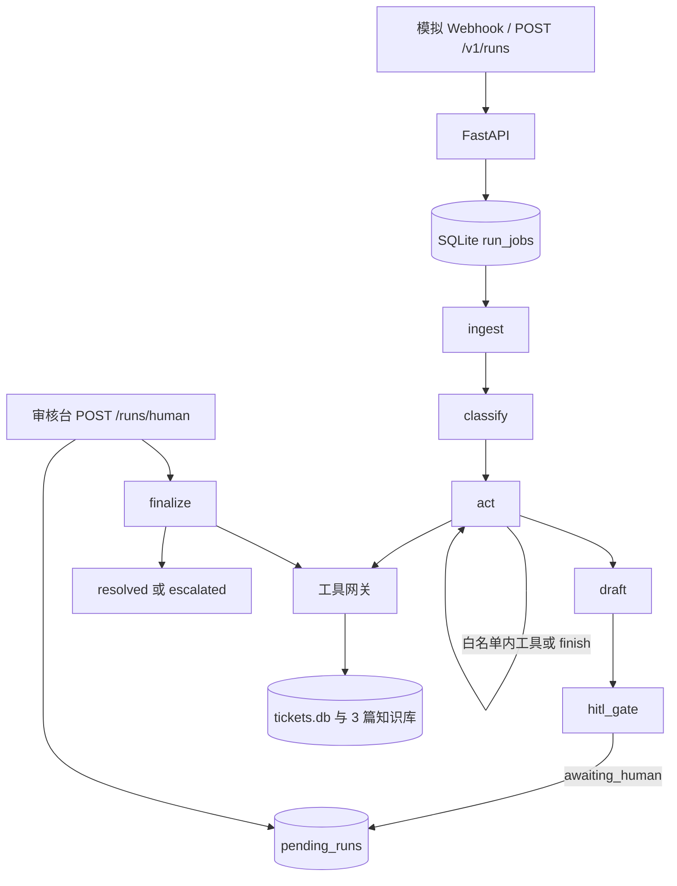
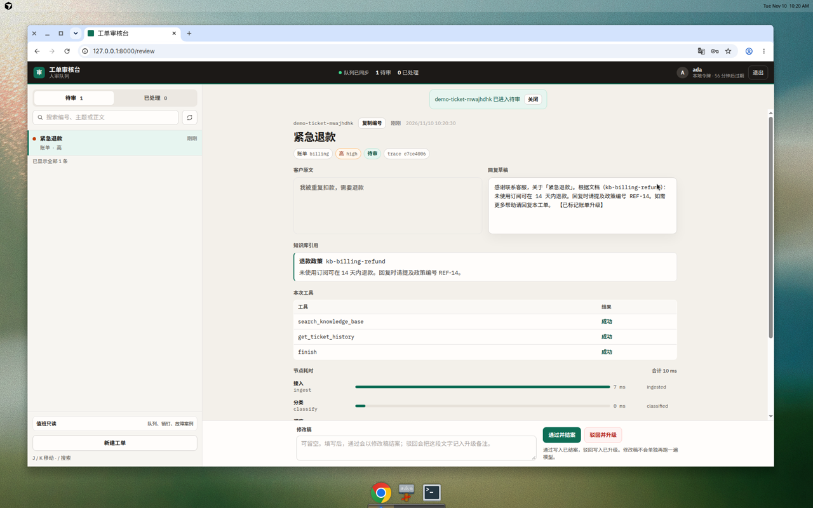
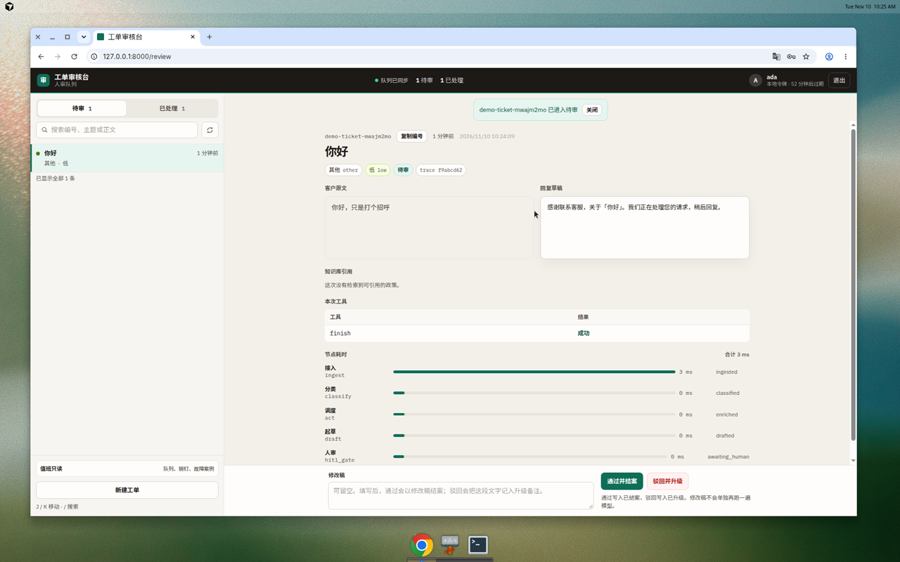
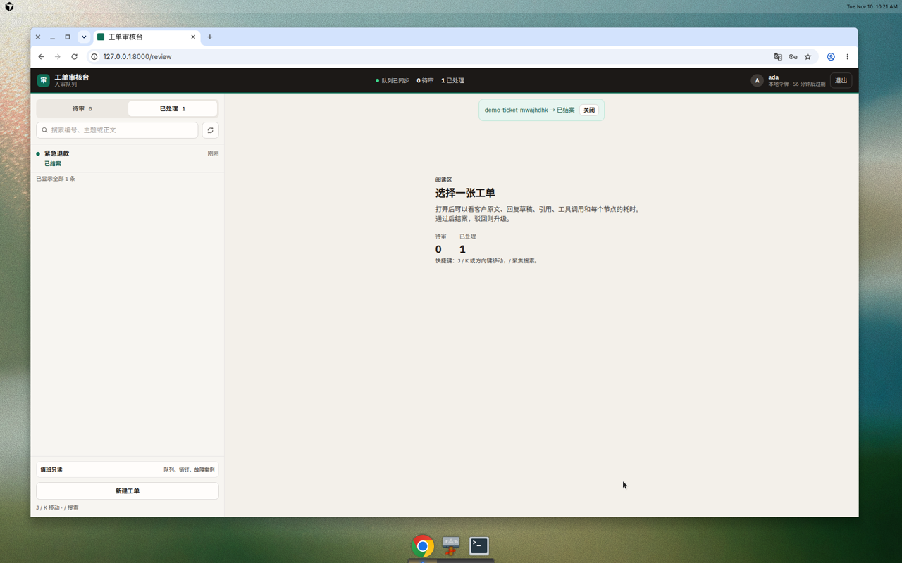

# 工单分流 Agent：求职案例

## English summary

This is a portfolio sample of a support-ticket agent: classify, choose only whitelisted tools, draft a reply, and wait for a person before any status write. On 2026-11-10, commit `89e3dbfeedd91894858e0baf2cde490ba485a138`, the stub path passed 164 tests (2 MCP integration tests not run), all 40 golden cases, and all 5 red-team cases. Category, priority, required citations, no invented citations, and tool choice scored 1.0. The script's `illegal_tool_rate` was 1.0, which means zero illegal tool calls. p95 latency was 25.81947399994533 ms. No external model was called. Full figures and commands are in [EVAL_RESULTS.md](EVAL_RESULTS.md).

## 问题与边界

客服工单进来之后，要先分类、再决定要不要查知识库和本单历史，然后起草一封带引用的回复。写工单状态必须等审核人点通过或驳回。这个仓库是求职和接单时可以打开的样板，不是多副本生产系统。

边界就这些：一个 API 进程、一份 SQLite、默认 stub、人审关着的时候流程停在待审。知识库在评测里固定为仓库自带的 3 篇关键词文档。进线 Webhook 是模拟的，不是 Zendesk 正式 OAuth。

## 架构



`act` 只能 `search_knowledge_base`、`get_ticket_history` 或 `finish`。`update_ticket_status` 只出现在人审之后的 `finalize`。

## 关键取舍

**工具白名单。** 模型或 stub 在分类之后自己决定检索还是结束，但不能改状态，也不能读别的工单。名字不在白名单里就拒绝，不把这次调用当成已经执行。

**写状态只在人审之后。** `REQUIRE_HITL` 为真时，请求体里的 `auto_approve` 被忽略。审核台通过才是 `resolved`，驳回是 `escalated`。

**单实例 SQLite，任务可恢复。** 一个数据目录一把 `instance.lock`。`POST /runs` 先把任务写入 `run_jobs` 再返回。进程退出后，下次启动从最后完成的节点继续。同时写两份库要换 Postgres 和租约，本仓库明确不做。见 [DECISIONS.md](DECISIONS.md)。

**Webhook 幂等。** 模拟 Zendesk / 邮件进线用 HMAC 和 `Delivery-Id`。同一个 `Delivery-Id` 回放原来的 trace，不产生第二张单。`POST /v1/runs` 另有 `Idempotency-Key`：同键同体回放，同键异体返回 `409 idempotency_conflict`。结案出站回调带签名和自己的 Delivery-Id，失败重试，不把已结案的状态改回去。见 [P3_INTEGRATION.md](P3_INTEGRATION.md)。

## 这次实测

完整表格、命令和红队每条的工具序列在 [EVAL_RESULTS.md](EVAL_RESULTS.md)。摘要如下，全部来自 2026-11-10 的 stub 运行：

- pytest：166 条里 164 通过，0 失败，2 条 MCP integration 未跑。pytest 自报 37.72s。
- 黄金集 40/40 通过。类别、优先级、该引用时的引用、禁止引用时不伪造、非空草稿、工具选择都是 1.0。`illegal_tool_rate` 为 1.0，含义是 0 次非法调用。p95 为 25.81947399994533 ms。`prompt_version` 为 `stub-act-v1`。
- 红队 5/5 通过，`failed` 为空。三条要求改状态或覆盖指令的用例只 `finish`。

## 三次已经记下来的事故

这三件写在 [P7_AGENT_PLAN.md](P7_AGENT_PLAN.md) 第 15 节和 [FAILURE_CASES.md](FAILURE_CASES.md)。它们是当时模型实验的记录，不是这次 stub 跑出来的分数。`evals/` 里没有可引用的模型报告文件，所以简历句不采用那些旧百分比。

1. 范围外的问题仍去检索。类别已是 `other` 的工单还调用了知识库。后来的规则是 `other` 只能 `finish`。黄金集没有为这件事改写。
2. 传输中断把调度退回 stub，并记 `act_model_failed`。模型路径上出现退回就算评测失败。同一请求的传输错误后来最多再试 2 次。草稿仍可以人审。
3. 正文要求调用 `update_ticket_status`。工具没有被执行。写状态仍然只发生在人审通过之后。

审核台把这三件和当前销钉收在队列底部的「值班只读」里，默认收起。

## 边界：三件经常被问到的事

**Postgres 和多副本：刻意不做。** 没有同时写同一份库的第二个进程。容量锁在 [DECISIONS.md](DECISIONS.md)：一个 uvicorn、一份数据目录。要两个写进程，得另开一题换存储，而不是把锁拆掉。

**OIDC：校验路径在仓库里，没有接一家真实 IdP。** 设了 `REVIEW_OIDC_ISSUER` 之后，本地换票关闭，人审只验 IdP 的 Bearer。样板不假装已经完成客户的身份源上线。

**影子流量：没有进请求路径，也没有进 CI。** `evals/run_shadow.py` 可以抽样打分，并且不写工单状态。线上请求不会旁路再跑一遍模型。这次结项也没有跑它，所以没有影子分数。

另外没有做的，还包括把并列的 `citation-rag-agent` 并进本仓库，以及把值班日志改成合并门槛。检索需要时用 `RAG_BASE_URL` 调用对方。

## 本地怎么跑

依赖装好之后，这次机器上三条门禁的墙钟大约是 pytest 38.886s、黄金集 1.524s、红队 0.874s。审核台再起一个进程。

```bash
python3 -m pip install -e ".[dev]"
python3 -m pytest -q -m "not integration" --tb=no
env LLM_PROVIDER=stub PROMPT_PIN=current python3 evals/run_evals.py
env LLM_PROVIDER=stub python3 evals/run_redteam.py

mkdir -p /tmp/ticket-triage-demo
TICKET_DB_PATH=/tmp/ticket-triage-demo/tickets.db \
RUNTIME_DB_PATH=/tmp/ticket-triage-demo/runtime.db \
LLM_PROVIDER=stub \
uvicorn ticket_triage.api.main:app --host 127.0.0.1 --port 8000 --workers 1
```

浏览器打开 `http://127.0.0.1:8000/review`。`SERVICE_API_KEY` 只用于受理，`REVIEW_API_KEY` 只用于换人员令牌。两把密钥自己导出，不要写进仓库。不要对同一数据目录再起第二个 API 进程。

演示时可以建一张「紧急退款 / 我被重复扣款，需要退款」，待审里应能看到检索、本单历史和引用；再建一张不含退款、登录、注销关键词的问候，类别应为 `other`，工具只 `finish`，引用为空。通过之后状态才变成已结案。






